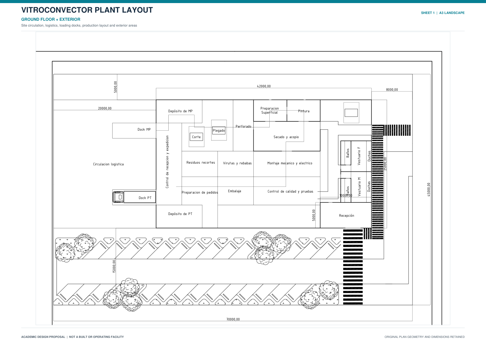
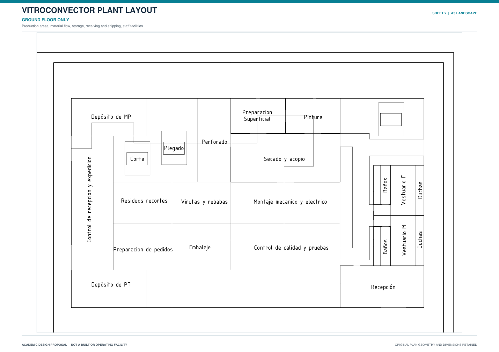
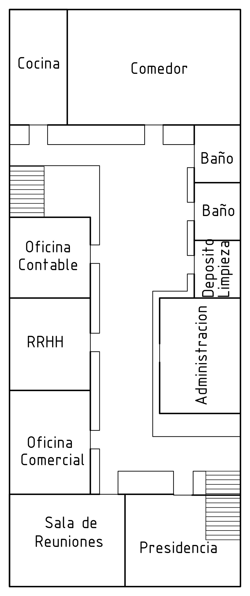

# Vitroconvector Manufacturing Plant Layout
### AutoCAD · Academic Mechatronics Engineering Project

A 2D layout proposal for a vitroconvector manufacturing facility. The project focuses on functional space allocation, production flow, storage, receiving and shipping, staff facilities, administration, and site circulation.

> **Project status:** Academic design proposal. The facility is not represented as built or operational.

## Presentation

**[Download the complete three-sheet A3 landscape presentation (PDF)](AutoCAD_Industrial_Plant_Layout_Portfolio_A3_Landscape.pdf)**

The portfolio contains three coordinated A3 landscape sheets: ground floor with exterior/site circulation, ground-floor production layout, and first-floor administration layout.

## 01 · Ground Floor + Exterior

Overview of production areas, logistics circulation, loading docks, storage, and exterior areas. The upper-floor layout is excluded.

[Open the A3 landscape PDF](pdfs/01_Ground_Floor_and_Exterior_A3_Landscape.pdf)

## 02 · Ground Floor Only

A closer view of production and support areas, excluding the upper floor and exterior site areas.

[Open the A3 landscape PDF](pdfs/02_Ground_Floor_Only_A3_Landscape.pdf)

## 03 · First Floor — Administration & Staff Facilities

The first-floor drawing identifies the accounting office, Human Resources, commercial office, administration office, presidency, meeting room, kitchen and dining room, bathrooms, cleaning/storage area, and stair/circulation areas. Room-by-room areas are not claimed because they are not verified in the source drawing.

[Open the A3 landscape PDF](pdfs/03_First_Floor_Administration_A3_Landscape.pdf)

## Design Basis

| Parameter | Value | Interpretation |
|---|---:|---|
| Reference annual market | 130,000 units | Planning assumption used in coursework |
| Target market share | 5% | Project objective |
| Derived annual production target | **6,500 units/year** | 130,000 × 0.05 |
| Site dimensions shown on the plan | 70 m × 45 m | Outer dimensions visible in the current site plan |
| Site area derived from the plan | **Approximately 3,150 m²** | 70 × 45 m |

The current portfolio uses **approximately 3,150 m²** as the site area because that is what the dimensioned plan shows. The initial 5,000 m² planning assumption is superseded for this version. The editable `.DWG` was not supplied, so the area is taken from the dimensions visible in the provided PDF rather than remeasured in the source drawing.

The 6,500-unit annual volume is a target derived from the assumed market size and 5% share, not a verified production result.

## Design Scope

The proposed production sequence includes raw-material storage, cutting, folding, perforating, surface preparation, painting, drying and staging, mechanical and electrical assembly, quality control and testing, packaging, order preparation, and finished-goods storage. The layout also represents receiving and shipping docks, personnel facilities, administration, and circulation.

## Source Files and Limitations

The repository contains presentation PDFs, previews, original PDF exports, and the source items that were available. The supplied AutoCAD files included a `.BAK` backup and a `.DWT` template; an editable `.DWG` was not included. Those files are preserved in the repository but are not claimed as substitutes for a verified editable drawing.

This repository documents academic CAD work. It does not claim structural calculations, regulatory approval, construction, or operational validation.

## Author

**Joaquín Núñez Cid** · Mechatronics Engineering Student

[GitHub Profile](https://github.com/JoaquinNunezCid) · [LinkedIn](https://www.linkedin.com/in/nunezcidjoaquin/)
